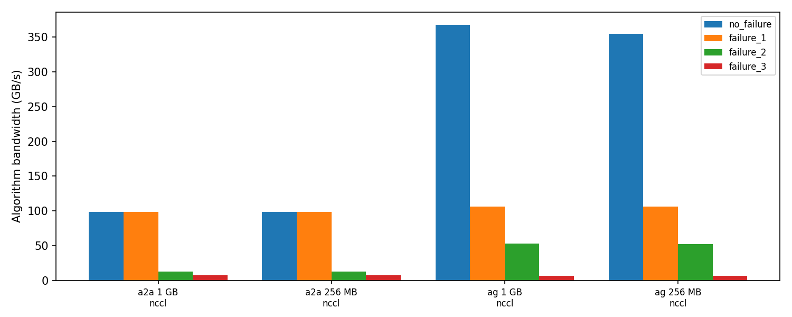

# MCCL artifact results: `04_static_failures`

## E2 - Single collectives on 16 GPUs (2 hosts x 8, rail-optimized) under gray failures

NCCL-equivalent MSCCL schedules through the custom-schedule path, with the configuration used for all MCCL experiments in the paper (512 KiB pipelining as in NCCL/MSCCL, PXN, 3 us send latency). AlgBW = collective size / completion time (GB/s). Slowdown is relative to the same workload and algorithm with no failure: static schedules collapse to the speed of the degraded link (the "Orig"/"No reopt" baselines of Fig. 1 and Fig. 8).

| coll | size | algorithm | failure | time (ms) | AlgBW (GB/s) | slowdown vs no failure | schedule used |
|---|---|---|---|---|---|---|---|
| A2A | 1 GB | nccl | no_failure | 10.863 | 98.85 | 1.00x | msccl |
| A2A | 1 GB | nccl | failure_1 | 10.863 | 98.85 | 1.00x | msccl |
| A2A | 1 GB | nccl | failure_2 | 86.933 | 12.35 | 8.00x | msccl |
| A2A | 1 GB | nccl | failure_3 | 152.423 | 7.04 | 14.03x | msccl |
| A2A | 256 MB | nccl | no_failure | 2.720 | 98.71 | 1.00x | msccl |
| A2A | 256 MB | nccl | failure_1 | 2.720 | 98.71 | 1.00x | msccl |
| A2A | 256 MB | nccl | failure_2 | 21.738 | 12.35 | 7.99x | msccl |
| A2A | 256 MB | nccl | failure_3 | 38.315 | 7.01 | 14.09x | msccl |
| AG | 1 GB | nccl | no_failure | 2.917 | 368.09 | 1.00x | msccl |
| AG | 1 GB | nccl | failure_1 | 10.085 | 106.47 | 3.46x | msccl |
| AG | 1 GB | nccl | failure_2 | 20.394 | 52.65 | 6.99x | msccl |
| AG | 1 GB | nccl | failure_3 | 163.038 | 6.59 | 55.89x | msccl |
| AG | 256 MB | nccl | no_failure | 0.757 | 354.77 | 1.00x | msccl |
| AG | 256 MB | nccl | failure_1 | 2.535 | 105.87 | 3.35x | msccl |
| AG | 256 MB | nccl | failure_2 | 5.114 | 52.49 | 6.76x | msccl |
| AG | 256 MB | nccl | failure_3 | 40.798 | 6.58 | 53.92x | msccl |

**Reference check** (`artifact/expected/E2-single.csv`): 16/16 runs identical to the authors' reference simulated times.

