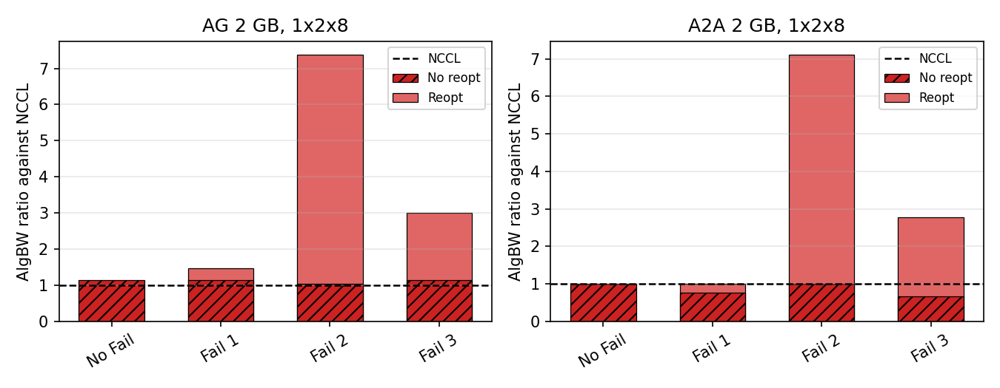

# MCCL artifact results: `05_reoptimization`

## E3 - MCCL schedules vs NCCL under gray failures (2 GB, 128 MB per source, 16 GPUs)

Per topology: NCCL; MCCL *no reopt* = the schedule synthesized for the healthy fabric, kept under the failure; MCCL *reopt* = the schedule re-synthesized for that failure. In parentheses: AlgBW ratio against NCCL (= T_NCCL / T), as in Fig. 1 and Fig. 8.

| coll | topology | NCCL | MCCL no reopt | MCCL reopt |
|---|---|---|---|---|
| AG | No Fail | 5.772 ms | 5.062 ms (1.14x) | - |
| AG | Fail 1 | 20.152 ms | 17.747 ms (1.14x) | 13.720 ms (1.47x) |
| AG | Fail 2 | 40.768 ms | 39.145 ms (1.04x) | 5.525 ms (7.38x) |
| AG | Fail 3 | 326.025 ms | 287.346 ms (1.13x) | 108.352 ms (3.01x) |
| A2A | No Fail | 21.720 ms | 21.733 ms (1.00x) | - |
| A2A | Fail 1 | 21.720 ms | 28.240 ms (0.77x) | 21.720 ms (1.00x) |
| A2A | Fail 2 | 173.859 ms | 173.861 ms (1.00x) | 24.445 ms (7.11x) |
| A2A | Fail 3 | 304.527 ms | 456.513 ms (0.67x) | 109.318 ms (2.79x) |

**Reference check** (`artifact/expected/E3-mccl.csv`): 22/22 runs identical to the authors' reference simulated times.

